# 🎯 파이썬 퀴즈 게임

콘솔에서 실행하는 파이썬 퀴즈 게임 프로젝트입니다.  
기본문제는 코드에 내장되어 있고, 사용자가 직접 문제를 추가/삭제할 수 있습니다.  
또한 랜덤 출제, 문제 수 선택, 힌트 기능, 점수 기록, 자동 저장, 백업 생성 기능을 제공합니다.

---

## 1. 프로젝트 개요

이 프로젝트는 사용자가 퀴즈를 풀고 점수를 확인할 수 있는 **콘솔 기반 퀴즈 게임**입니다.  
기본 문제는 코드에 포함되어 있으며, 사용자가 추가한 문제와 기록은 `state.json` 파일에 저장됩니다.

### 주요 특징
- 기본 퀴즈 11개 내장 (default_questions.json)
- 사용자 문제 추가 및 삭제
- 랜덤 출제
- 출제할 문제 수 선택
- 힌트 기능
- 힌트 사용 시 2점 감점
- 점수 기록 저장
- `state.json` 기반 데이터 저장/불러오기
- 자동 백업 생성
- 최근 백업 10개만 유지
- 중복 문제 추가 방지
- 기본 문제 삭제 불가

---

## 2. 퀴즈 주제 선정 이유

퀴즈 게임은 Python의 기본 문법, 조건문, 반복문, 리스트/딕셔너리, 파일 저장/불러오기 등을 자연스럽게 활용할 수 있는 주제입니다.  
또한 실행 결과가 바로 보이기 때문에 학습용 프로젝트로 적합하다고 생각했습니다.

이 프로젝트를 통해 다음을 연습할 수 있습니다.

- 객체지향 프로그래밍
- 파일 입출력
- 예외 처리
- 데이터 저장 및 복원
- 사용자 입력 처리
- 랜덤 출제 로직 구현

---

## 3. 실행 방법

### 1) Python 설치 확인
터미널 또는 명령 프롬프트에서 다음 명령어를 입력합니다.

```bash
python --version
```
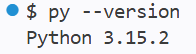

환경에 따라 다음을 사용할 수도 있습니다.

```bash
python3 --version
```

### 2) 프로젝트 실행
프로젝트 폴더로 이동한 뒤 아래 명령어를 실행합니다.

```bash
python main.py
```

환경에 따라:

```bash
python3 main.py
```

> 실행 파일 이름은 프로젝트 구조에 맞게 수정하세요.

---

## 4. 기능 목록

- 기본 퀴즈 11개 제공
- 사용자 퀴즈 추가
- 퀴즈 목록 출력
- 랜덤 퀴즈 출제
- 원하는 문제 수만큼 선택 가능
- 힌트 기능 사용 가능
- 힌트 사용 시 2점 차감
- 사용자 퀴즈 삭제 가능
- 기본 퀴즈 삭제 불가
- 점수 기록 저장
- 최고 점수 및 히스토리 관리
- `state.json` 자동 저장
- 저장 시 백업 파일 자동 생성
- 최근 백업 10개만 유지
- 중복 문제 추가 방지
- 잘못된 입력 예외 처리

---

## 5. 파일 구조

```text
quizGN/
├── images/
├── main.py
├── quiz.py
├── quiz_game.py
├── default_questions.json
├── state.json
├── backups/
└── README.md
```

> 실행 중 `state.json` 및 `backups/` 폴더는 자동 생성될 수 있습니다.

---

## 6. 데이터 파일 설명

### `state.json`
사용자 출제 퀴즈와 점수 기록이 저장되는 파일입니다.

#### 저장 내용 예시
- 사용자 추가 문제 목록
- 퀴즈 결과 기록
- 최고 점수
- 최근 플레이 기록

### 백업 파일
저장 시 백업 파일이 함께 생성됩니다.  
이 파일은 데이터 손실을 방지하기 위한 용도이며, 최근 10개까지만 유지됩니다.

### 기본 문제
기본문제는 `default_questions`에 있어 `state.json`에 저장되지 않습니다.  
따라서 삭제되거나 잘못 덮어써지는 일이 없습니다.

---

## 7. 클래스 책임 분리

### `Quiz` 클래스
`Quiz` 클래스는 **퀴즈 한 문제의 데이터를 표현하는 모델**입니다.  
문제, 정답, 힌트 같은 정보를 저장하는 역할만 담당하며, 게임 진행이나 입력 처리는 하지 않습니다.

### `QuizGame` 클래스
`QuizGame` 클래스는 **퀴즈 게임의 전체 진행을 담당하는 로직 클래스**입니다.  
문제 출제, 정답 판정, 점수 계산, 저장/불러오기, 사용자 입력 처리 같은 기능을 관리합니다.

이렇게 분리하면 **문제 데이터와 게임 진행 로직이 섞이지 않아서** 유지보수가 쉬워지고, 기능을 수정할 때 영향 범위를 줄일 수 있습니다.

---

## 8. 클래스 주요 메서드

이 프로젝트에서 클래스를 사용한 이유는 **추상화와 재사용성**을 높이기 위해서입니다.

- `Quiz`는 문제 1개의 공통 구조를 표현하므로, 여러 문제를 같은 방식으로 다룰 수 있습니다.
- `QuizGame`은 퀴즈 진행 흐름을 한 곳에서 관리하므로, 메뉴나 기능이 추가되어도 전체 구조를 유지하기 쉽습니다.

즉, 클래스를 사용하면 기능이 늘어나도 코드 구조가 흐트러지지 않고, 같은 형태의 데이터를 반복해서 처리하기 편해집니다.

| 클래스 | 주요 메서드 | 책임 |
|---|---|---|
| `main` | `main()` | `QuizGame` 인스턴스를 생성하고 게임 실행을 시작함 |
| `Quiz` | `__post_init__()` | 퀴즈 데이터의 유효성 검사 및 정리 수행 |
| `Quiz` | `display()` | 문제와 선택지를 화면에 출력함 |
| `Quiz` | `check_answer(user_answer)` | 사용자의 답이 정답인지 판별함 |
| `Quiz` | `to_dict()` | 객체를 JSON 저장용 딕셔너리로 변환함 |
| `Quiz` | `from_dict(data)` | 딕셔너리 데이터를 기반으로 `Quiz` 객체를 복원함 |
| `QuizGame` | `__init__()` | 게임 상태 초기화, 기본 문제 로드, 저장 상태 불러오기, 시그널 등록 |
| `QuizGame` | `default_questions()` | `default_questions.json`에서 기본 문제를 읽어옴 |
| `QuizGame` | `is_default_quiz(quiz)` | 해당 퀴즈가 기본 문제인지 확인함 |
| `QuizGame` | `normalize_text(text)` | 문제 비교를 위한 문자열 정규화 수행 |
| `QuizGame` | `is_duplicate_question(question)` | 중복된 문제가 있는지 검사함 |
| `QuizGame` | `input_menu()` | 메뉴를 출력하고 사용자 선택을 입력받음 |
| `QuizGame` | `input_quiz_data()` | 새 퀴즈 등록에 필요한 데이터를 입력받음 |
| `QuizGame` | `input_answer(quiz)` | 퀴즈 풀이 중 정답을 입력받습니다. `h` 입력 시 힌트를 출력합니다. |
| `QuizGame` | `add_quiz(...)` | 새 퀴즈를 추가하고 저장함 |
| `QuizGame` | `show_quizzes()` | 저장된 퀴즈 목록을 출력함 |
| `QuizGame` | `play_quiz()` | 퀴즈를 출제하고 점수를 계산함 |
| `QuizGame` | `delete_quiz()` | 선택한 퀴즈를 삭제함 |
| `QuizGame` | `show_history()` | 게임 점수 기록을 출력함 |
| `QuizGame` | `load_state()` | 저장된 상태를 읽어와 현재 게임 상태를 복원함 |
| `QuizGame` | `backup_state_file()` | `state.json`을 백업하고 최근 10개의 백업만 유지함 |
| `QuizGame` | `save_state()` | 현재 퀴즈, 최고 점수, 기록을 파일로 저장함 |
| `QuizGame` | `update_high_score()` | 최고 점수를 갱신함 |
| `QuizGame` | `handle_exit_signal(signum, frame)` | 종료 신호를 처리하고 저장 후 종료함 |
| `QuizGame` | `register_signal_handlers()` | 종료 신호 핸들러를 등록함 |
| `QuizGame` | `run()` | 메뉴 루프를 실행하며 전체 게임 흐름을 관리함 |

---

## 9. 입력 검증 / 게임 진행 / 데이터 입출력 분리

이 프로젝트는 기능을 다음 3개 영역으로 나누어 설계했습니다.

- **input 영역**  
  사용자의 입력을 받는 부분입니다.  
  메뉴 선택, 숫자 입력, yes/no 확인처럼 잘못된 입력을 걸러내는 역할을 합니다.

- **logic 영역**  
  퀴즈의 실제 규칙을 처리하는 부분입니다.  
  문제 출제, 정답 비교, 점수 계산, 중복 문제 검사 같은 게임 동작을 담당합니다.

- **io 영역**  
  파일과 데이터를 다루는 부분입니다.  
  `state.json` 저장/불러오기, 백업 생성, JSON 처리 같은 작업을 담당합니다.

이렇게 나누면 입력 방식이 바뀌어도 게임 규칙에는 영향이 적고, 저장 방식이 바뀌어도 퀴즈 로직을 크게 수정하지 않아도 됩니다.

---

## 10. `state.json` 저장 형식을 선택한 이유

`state.json`은 사람이 읽기 쉬운 JSON 형식이기 때문에, 저장된 데이터를 직접 확인하기 쉽습니다.  
또한 문제 목록과 기록을 **구조화된 형태**로 저장할 수 있어, Python에서 읽고 쓰기 편합니다.

즉, `state.json`은 **가독성, 구조화, 구현 편의성** 측면에서 적합한 저장 방식입니다.

---

## 11. `state.json` 처리 순서

### 로드 순서
1. 프로그램 시작 시 `state.json` 파일이 있는지 확인합니다.
2. 파일이 존재하면 내용을 읽어 사용자 문제와 기록을 불러옵니다.
3. 불러온 사용자 데이터는 코드에 있는 기본 문제와 합쳐서 사용합니다.
4. 파일이 없거나 내용이 비어 있으면 기본 문제만 사용하고 새로 시작합니다.

### 저장 순서
1. 저장 전에 기존 `state.json`이 있으면 백업 파일을 먼저 생성합니다.
2. 현재 상태를 JSON 형식으로 정리합니다.
3. 마지막으로 `state.json`에 최신 내용을 덮어씁니다.

이 순서를 통해 기본 문제는 코드에 유지하고, 사용자 문제와 기록은 안전하게 관리할 수 있습니다.

### state 구조
```bash
    "high_score":            # 최고점수를 기록합니다
    "id":                   # 기본문제(default)와 추가문제(user)를 구분하는 id입니다
    "question"              # 문제입니다 문자열로 받아옵니다
    "choices": []           # 선택지입니다 리스트형으로 받아옵니다
    "answer":               # 정답번호 입니다 정수형으로 받아옵니다
    "points": 10            # 기본점수는 10점입니다
    "history":              # 점수기록 히스토리를 불러옵니다
```

---

## 12. 종료 처리와 안전 저장

프로그램이 강제 종료되거나 `Ctrl + C`가 입력되면, 종료 핸들러가 실행되어 현재 상태를 저장합니다.  
이 방식은 작업 중이던 사용자 문제와 기록이 최대한 보존되도록 돕습니다.

종료 시 저장이 실패할 수 있으므로, 프로그램은 예외를 처리하고 필요하면 다시 저장할 수 있도록 구성합니다.  
이렇게 하면 예기치 않은 종료 상황에서도 데이터 손실을 줄일 수 있습니다.

---

## 13. 커밋 단위와 메시지 규칙

커밋은 기능과 수정 내용을 명확하게 나누어 작성합니다.  
하나의 커밋에는 보통 하나의 목적만 담는 것을 원칙으로 합니다.

### 커밋 단위 기준
- 기능 추가 1개
- 버그 수정 1개
- 문서 수정 1개
- 구조 개선 1개

### 커밋 메시지 템플릿
- `feat: 기능 추가`
- `fix: 버그 수정`
- `refactor: 구조 개선`
- `docs: 문서 수정`
- `test: 테스트 코드 추가`

### 예시
- `feat: 사용자 문제 추가 기능 구현`
- `fix: 중복 문제 출제 오류 수정`
- `docs: README에 저장 순서 설명 추가`

---

## 14. GitHub 업로드 및 작업 기록

이 프로젝트는 GitHub에 업로드되어 있으며, 브랜치 작업과 병합을 포함한 작업 기록이 있습니다.

### checkout
다른 브랜치로 바꾸거나 예전 커밋 상태로 돌아갈 때 쓰는 명령어 입니다.
```bash
git checkout (브랜치명)
```
### merge
다른 브랜치의 변경 내용을 현재 브랜치에 합치는 것입니다.
```bash
git merge
```

추가로 합칠 내용이 없을땐 아래 메시지가 출력됩니다.
```bash
Already up to date.
```

### 
```bash
git checkout -b feature   # 새 브랜치 생성 후 이동
# 코드 수정
git add .
git commit -m "브랜치 실습"

git checkout main              # main으로 이동
git merge feature         # feature 내용을 main에 합침
```
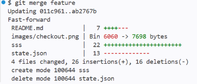

### clone

원격저장소의 내용을 새로운 폴더에 그대로 복사합니다.

```bash
git clone https://github.com/yhan1524/quizGN.git
```
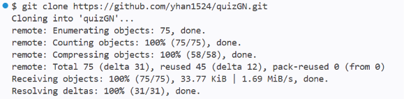

### pull

원격저장소에 있는 프로젝트의 변경사항을 그대로 로컬저장소에 옮겨와 자동으로 병합합니다

```bash
git pull origin main
```
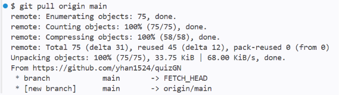

#### 주요 커밋 메시지

브랜치/병합 내역을 보여줍니다.<p>
로그 화면을 종료하려면 터미널에서 'q'를 입력합니다

```bash
git log --graph --oneline --decorate
* ab2767b (HEAD -> main, feature) 브랜치 실습
* 011c961 (origin/main, origin/HEAD) 기본문제추가
* 7e97896 체크아웃 수정
...
```

VScode에서는 좌측 Source Control에서도 확인할 수 있습니다.<p>
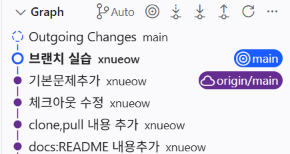

---

## 15. 파일 입출력 예외 처리와 복구 방법

이 프로젝트는 JSON 파일 읽기/쓰기 중 발생할 수 있는 오류를 예외 처리로 대응합니다.  
예를 들어 파일이 손상되었거나 권한 문제가 있으면 저장 또는 불러오기 과정에서 예외가 발생할 수 있습니다.

### 권장 조치
- 파일 권한을 확인합니다.
- `state.json`이 손상된 경우 백업 파일을 확인합니다.
- 저장이 실패하면 디스크 공간과 폴더 권한을 점검합니다.

### 백업 복구 방법
1. `backups/` 폴더를 엽니다.
2. 가장 최근의 정상 백업 파일을 찾습니다.
3. 해당 파일을 `state.json`으로 복원합니다.
4. 프로그램을 다시 실행합니다.

---

## 16. 1000개 이상 데이터 확장성 분석

현재 구조는 퀴즈 데이터를 메모리에서 불러와 처리하므로, 데이터가 1000개 이상으로 늘어나면 비용이 커질 수 있습니다.

- **메모리 사용량 증가**: 퀴즈 목록과 기록을 한 번에 메모리에 올리면 사용량이 늘어납니다.
- **검색 속도 저하**: 중복 검사나 특정 문제 탐색을 순차 검색으로 하면 데이터가 많을수록 느려질 수 있습니다.
- **저장/불러오기 시간 증가**: `state.json` 파일이 커질수록 읽기와 쓰기 시간이 길어질 수 있습니다.

### 개선 방향
- `set` 또는 `dict` 기반 중복 검사로 검색 속도를 개선합니다.
- 데이터가 커지면 필요한 데이터만 읽는 방식으로 바꿀 수 있습니다.
- 사용자 문제와 기록을 분리 저장하는 방법도 고려할 수 있습니다.

---

## 17. 요구 변경 시 수정 대상

기능 요구가 바뀌면 아래 모듈과 메서드를 우선적으로 수정해야 합니다.

- **점수 계산 변경**
  - 점수 부여 방식, 힌트 사용 시 감점 규칙, 정답 판정 로직
  - 관련 메서드: `QuizGame`의 점수 계산/정답 처리 부분

- **퀴즈 모델 변경**
  - 문제 구조에 새 필드 추가, 예: 난이도, 카테고리, 설명
  - 관련 클래스: `Quiz`

- **데이터 저장 방식 변경**
  - `state.json` 저장 구조, 로드 방식, 백업 방식 수정
  - 관련 메서드: 저장/불러오기/백업 처리 함수

- **문제 출제 방식 변경**
  - 랜덤 출제, 문제 수 선택, 중복 방지 규칙 수정
  - 관련 메서드: 문제 선택 및 출제 관련 로직

- **입력 방식 변경**
  - 메뉴 입력, 숫자 검증, yes/no 확인 방식 수정
  - 관련 함수: 입력 검증 함수

이처럼 수정 위치를 나누어 두면, 요구가 바뀌더라도 어떤 부분을 고쳐야 하는지 빠르게 파악할 수 있습니다.

---

## 18. 프로그램 실행 결과

- main.py 실행
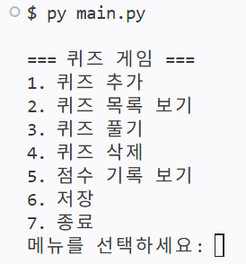

- 퀴즈 추가

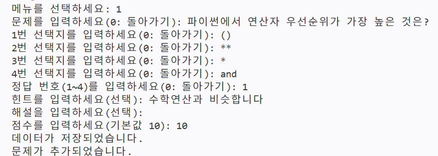

- 퀴즈 목록 보기

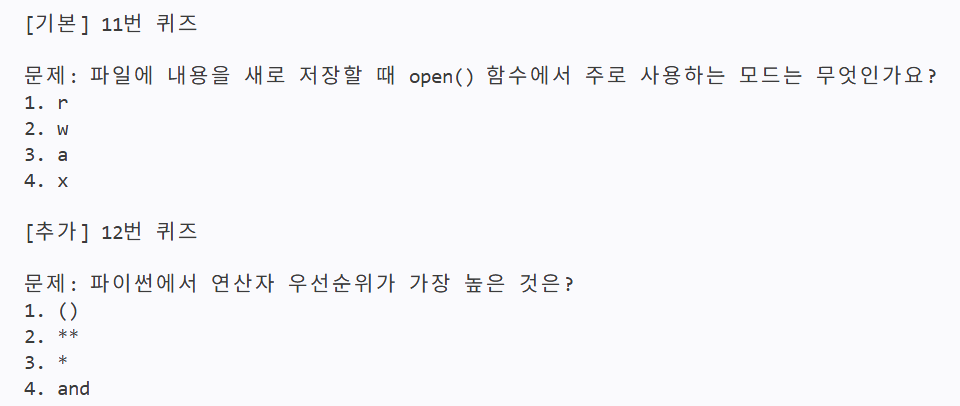

- 퀴즈 풀기

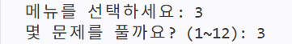
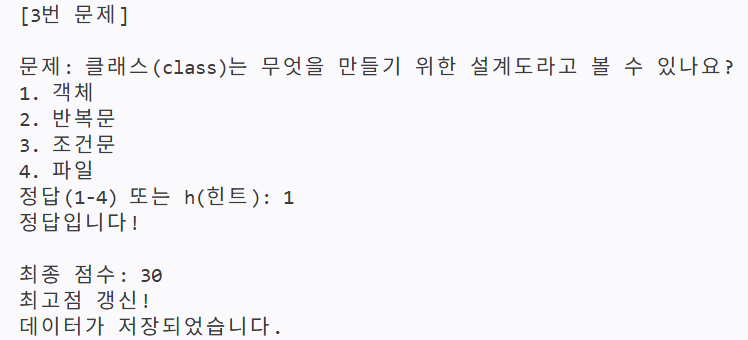

- 퀴즈 삭제

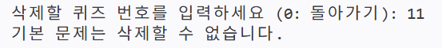
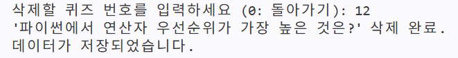

- 점수 기록 보기
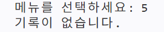
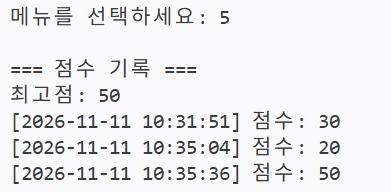

- 저장

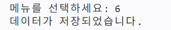

- 종료

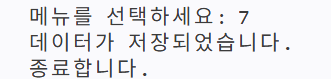


---

## 19. 마무리

이 프로젝트는 Python의 기본 문법과 파일 저장 기능을 활용해 만든 퀴즈 게임입니다.  
직접 문제를 추가하고 풀어보면서 학습 내용을 복습할 수 있도록 구성했습니다.

또한 단순한 기능 구현에 그치지 않고,  
**입력 처리 / 게임 로직 / 데이터 저장**을 분리해 설계하여 유지보수와 확장성을 고려했습니다.
