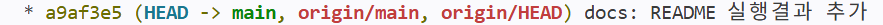

# 🎯 파이썬 퀴즈 게임

콘솔에서 실행하는 파이썬 퀴즈 게임 프로젝트입니다.  
기본문제는 코드에 내장되어 있고, 사용자가 직접 문제를 추가/삭제할 수 있습니다.  
또한 랜덤 출제, 문제 수 선택, 힌트 기능, 점수 기록, 자동 저장, 백업 생성 기능을 제공합니다.

---

## 1. 프로젝트 개요

이 프로젝트는 사용자가 퀴즈를 풀고 점수를 확인할 수 있는 **콘솔 기반 퀴즈 게임**입니다.  
기본 문제는 코드에 포함되어 있으며, 사용자가 추가한 문제와 기록은 `state.json` 파일에 저장됩니다.

### 주요 특징
- 기본 퀴즈 11개 내장 (default_questions.json)
- 사용자 문제 추가 및 삭제
- 랜덤 출제
- 출제할 문제 수 선택
- 힌트 기능
- 힌트 사용 시 2점 감점
- 점수 기록 저장
- `state.json` 기반 데이터 저장/불러오기
- 자동 백업 생성
- 최근 백업 10개만 유지
- 중복 문제 추가 방지
- 기본 문제 삭제 불가

---

## 2. 퀴즈 주제 선정 이유

퀴즈 게임은 Python의 기본 문법, 조건문, 반복문, 리스트/딕셔너리, 파일 저장/불러오기 등을 자연스럽게 활용할 수 있는 주제입니다.  
또한 실행 결과가 바로 보이기 때문에 학습용 프로젝트로 적합하다고 생각했습니다.

이 프로젝트를 통해 다음을 연습할 수 있습니다.

- 객체지향 프로그래밍
- 파일 입출력
- 예외 처리
- 데이터 저장 및 복원
- 사용자 입력 처리
- 랜덤 출제 로직 구현

---

## 3. 실행 방법

### 1) Python 설치 확인
터미널 또는 명령 프롬프트에서 다음 명령어를 입력합니다.

```bash
python --version
```


환경에 따라 다음을 사용할 수도 있습니다.

```bash
python3 --version
```

### 2) 프로젝트 실행
프로젝트 폴더로 이동한 뒤 아래 명령어를 실행합니다.

```bash
python main.py
```

환경에 따라:

```bash
python3 main.py
```

> 실행 파일 이름은 프로젝트 구조에 맞게 수정하세요.

---

## 4. 기능 목록

- 기본 퀴즈 11개 제공
- 사용자 퀴즈 추가
- 퀴즈 목록 출력
- 랜덤 퀴즈 출제
- 원하는 문제 수만큼 선택 가능
- 힌트 기능 사용 가능
- 힌트 사용 시 2점 차감
- 사용자 퀴즈 삭제 가능
- 기본 퀴즈 삭제 불가
- 점수 기록 저장
- 최고 점수 및 히스토리 관리
- `state.json` 자동 저장
- 저장 시 백업 파일 자동 생성
- 최근 백업 5개만 유지
- 중복 문제 추가 방지
- 잘못된 입력 예외 처리

---

## 5. 파일 구조

```text
quizGN/
├── images/
├── main.py
├── quiz.py
├── quiz_game.py
├── default_questions.json
├── state.json
├── backups/
└── README.md
```

> 실행 중 `state.json` 및 `backups/` 폴더는 자동 생성될 수 있습니다.

---

## 6. 데이터 파일 설명

### `state.json`
사용자 출제 퀴즈와 점수 기록이 저장되는 파일입니다.

#### 저장 내용 예시
- 사용자 추가 문제 목록
- 퀴즈 결과 기록
- 최고 점수
- 최근 플레이 기록

### 백업 파일
저장 시 백업 파일이 함께 생성됩니다.  
이 파일은 데이터 손실을 방지하기 위한 용도이며, 최근 10개까지만 유지됩니다.

### 기본 문제
기본문제는 `default_questions`에 있어 `state.json`에 저장되지 않습니다.  
따라서 삭제되거나 잘못 덮어써지는 일이 없습니다.

---

## 7. 클래스 책임 분리

### `Quiz` 클래스
`Quiz` 클래스는 **퀴즈 한 문제의 데이터를 표현하는 모델**입니다.  
문제, 정답, 힌트 같은 정보를 저장하는 역할만 담당하는 곳 입니다.

### `QuizGame` 클래스
`QuizGame` 클래스는 **퀴즈 게임의 전체 진행을 담당하는 로직 클래스**입니다.  
문제 출제, 정답 판정, 점수 계산, 저장/불러오기, 사용자 입력 처리 같은 기능을 관리합니다.

이렇게 분리하면 **문제 데이터와 게임 진행 로직이 섞이지 않아서** 유지보수가 쉬워지고, 기능을 수정할 때 영향 범위를 줄일 수 있습니다.

---

## 8. 클래스 주요 메서드

이 프로젝트에서 클래스를 사용한 이유는 **추상화와 재사용성**을 높이기 위해서입니다.

### Quiz 클래스

| 메서드 | 역할 | 설명 |
|---|---|---|
| __post_init__(self) | 객체 유효성 검증 | id, question, choices, answer, points 값이 올바른지 검사하고 정리 |
| display(self) | 문제 출력 | 문제와 4개 선택지를 화면에 출력 |
| check_answer(self, user_answer) | 정답 확인 | 입력한 답이 정답과 같은지 비교 |
| to_dict(self) | 딕셔너리 변환 | 퀴즈 데이터를 JSON 저장용 딕셔너리로 변환 |
| from_dict(cls, data) | 딕셔너리 → 객체 변환 | 저장된 데이터를 검사한 뒤 Quiz 객체로 복원 |

### QuizGame 클래스

| 메서드 | 역할 설명 |
|---|---|
| `__init__` | 게임 객체를 초기화하고 기본 경로, 파일 경로, 기본 퀴즈, 초기 상태, 종료 신호 처리 등을 설정한다. |
| `default_questions` | `default_questions.json` 파일에서 기본 문제를 읽어와 `Quiz` 객체 목록으로 변환한다. |
| `reset_state` | 퀴즈 목록, 최고점, 기록, 현재 점수를 초기 상태로 되돌린다. |
| `_user_quizzes` | 전체 퀴즈 중 기본 문제를 제외한 사용자 추가 퀴즈만 반환한다. |
| `_next_user_quiz_id` | 새로 추가할 사용자 퀴즈의 ID를 생성한다. |
| `is_default_quiz` | 해당 퀴즈가 기본 문제인지 판별한다. |
| `normalize_text` | 문자열의 공백을 제거하고 소문자로 변환해 비교용으로 정규화한다. |
| `is_duplicate_question` | 입력한 문제가 이미 존재하는지 중복 여부를 검사한다. |
| `input_menu` | 메뉴를 출력하고 사용자의 선택을 입력받는다. |
| `input_quiz_data` | 새 퀴즈의 문제, 선택지, 정답, 힌트, 해설, 점수를 입력받고 검증한다. |
| `input_answer` | 퀴즈 풀이 중 정답 입력 또는 힌트 요청을 처리한다. |
| `add_quiz` | 중복 검사를 거쳐 새 퀴즈를 추가하고 저장한다. |
| `show_quizzes` | 저장된 모든 퀴즈를 출력한다. 기본 문제와 추가 문제를 구분해서 보여준다. |
| `show_history` | 점수 기록과 최고점을 출력한다. |
| `play_quiz` | 퀴즈를 랜덤으로 선택해 출제하고, 정답 여부에 따라 점수를 계산한다. |
| `delete_quiz` | 사용자가 선택한 퀴즈를 삭제한다. 기본 문제는 삭제하지 못하게 막는다. |
| `load_state` | `state.json` 파일에서 저장된 퀴즈, 최고점, 기록을 불러온다. |
| `backup_state_file` | 저장 파일을 백업 폴더에 복사하고 오래된 백업 파일을 정리한다. |
| `save_state` | 사용자 퀴즈, 최고점, 기록을 JSON 파일로 저장한다. |
| `update_high_score` | 현재 점수가 최고점보다 높으면 최고점을 갱신한다. |
| `register_signal_handlers` | ctrl+c 종료 처리 |
| `run` | 메뉴를 반복 실행하면서 퀴즈 추가, 조회, 풀이, 삭제, 저장, 종료를 관리한다. |

즉, 클래스를 사용하면 기능이 늘어나도 코드 구조가 흐트러지지 않고, 같은 형태의 데이터를 반복해서 처리하기 편해집니다.

---

## 9. 기능별 정리

| 기능 | 메서드 |
|---|---|
| 객체 검증 및 정리 | `__post_init__` |
| 화면 출력 | `display` |
| 정답 확인 | `check_answer` |
| 저장용 변환 | `to_dict` |
| 복원용 변환 | `from_dict` |
| 초기화 / 상태 설정 | `__init__`, `reset_state`, `default_questions` |
| 문자열 / 중복 검사 | `normalize_text`, `is_default_quiz`, `is_duplicate_question`, `_user_quizzes`, `_next_user_quiz_id` |
| 입력 처리 | `input_menu`, `input_quiz_data`, `input_answer` |
| 퀴즈 관리 | `add_quiz`, `show_quizzes`, `delete_quiz` |
| 게임 진행 / 점수 | `play_quiz`, `update_high_score`, `show_history` |
| 저장 / 복구 / 백업 | `load_state`, `backup_state_file`, `save_state` |
| 종료 처리 / 실행 흐름 | `register_signal_handlers`, `run` |

이렇게 나누면 입력 방식이 바뀌어도 게임 규칙에는 영향이 적고, 저장 방식이 바뀌어도 퀴즈 로직을 크게 수정하지 않아도 됩니다.

---

## 10. `state.json` 저장 형식을 선택한 이유

`state.json`은 사람이 읽기 쉬운 JSON 형식이기 때문에, 저장된 데이터를 직접 확인하기 쉽습니다.  
또한 문제 목록과 기록을 **구조화된 형태**로 저장할 수 있어, Python에서 읽고 쓰기 편합니다.

즉, `state.json`은 **가독성, 구조화, 구현 편의성** 측면에서 적합한 저장 방식입니다.

---

## 11. `state.json` 처리 순서

### 로드 순서
1. 프로그램 시작 시 `state.json` 파일이 있는지 확인합니다.
2. 파일이 존재하면 내용을 읽어 사용자 문제와 기록을 불러옵니다.
3. 불러온 사용자 데이터는 코드에 있는 기본 문제와 합쳐서 사용합니다.
4. 파일이 없거나 내용이 비어 있으면 기본 문제만 사용하고 새로 시작합니다.

### 저장 순서
1. 저장 전에 기존 `state.json`이 있으면 백업 파일을 먼저 생성합니다.
2. 현재 상태를 JSON 형식으로 정리합니다.
3. 마지막으로 `state.json`에 최신 내용을 덮어씁니다.

이 순서를 통해 기본 문제는 코드에 유지하고, 사용자 문제와 기록은 안전하게 관리할 수 있습니다.

### state 구조
```bash
    "high_score":            # 최고점수를 기록합니다
    "id":                   # 기본문제(default)와 추가문제(user)를 구분하는 id입니다
    "question"              # 문제입니다 문자열로 받아옵니다
    "choices": []           # 선택지입니다 리스트형으로 받아옵니다
    "answer":               # 정답번호 입니다 정수형으로 받아옵니다
    "points": 10            # 기본점수는 10점입니다
    "history":              # 점수기록 히스토리를 불러옵니다
```

---

## 12. 종료 처리와 안전 저장

프로그램이 강제 종료되거나 `Ctrl + C`가 입력되면, 종료 핸들러가 실행되어 현재 상태를 저장합니다.  
이 방식은 작업 중이던 사용자 문제와 기록이 최대한 보존되도록 돕습니다.

종료 시 저장이 실패할 수 있으므로, 프로그램은 예외를 처리하고 필요하면 다시 저장할 수 있도록 구성합니다.  
이렇게 하면 예기치 않은 종료 상황에서도 데이터 손실을 줄일 수 있습니다.

---

## 13. 커밋 단위와 메시지 규칙

커밋은 기능과 수정 내용을 명확하게 나누어 작성합니다.  
하나의 커밋에는 보통 하나의 목적만 담는 것을 원칙으로 합니다.

### 커밋 단위 기준
- 기능 추가 1개
- 버그 수정 1개
- 문서 수정 1개
- 구조 개선 1개

### 커밋 메시지 템플릿
- `feat: 기능 추가`
- `fix: 버그 수정`
- `refactor: 구조 개선`
- `docs: 문서 수정`
- `test: 테스트 코드 추가`

### 예시


---

## 14. GitHub 업로드 및 작업 기록

이 프로젝트는 GitHub에 업로드되어 있으며, 브랜치 작업과 병합을 포함한 작업 기록이 있습니다.

### init
새 Git 저장소를 시작하는 명령어, 현재 폴더를 Git으로 관리하겠다는 의미입니다<p>
`.git` 폴더가 생성됩니다
```bash
git init
```
### add
변경한 파일을 커밋할 준비 목록에 올리는 명령어로, 바로 저장하는 것이 아니라 저장을 표시하는 단계입니다
```bash
git add .     #.은 현재 폴더의 변경사항 전체를 추가하는 것
```
### commit
추가된 변경 사항을 저장하는 명령어, 버전을 저장/관리하기 위해 사용합니다
```bash
git commit -m "커밋메시지"
```
### push
로컬 저장소의 커밋 내용을 원격저장소로 업로드 하는 명령어 입니다.
```bash
git push -u origin main # --set-upstream
git push    # 처음 push에서 -u 위치 지정을 한다면 다음 push 부터는 위치정보는 생략 가능합니다 
```

### checkout
다른 브랜치로 바꾸거나 예전 커밋 상태로 돌아갈 때 쓰는 명령어 입니다.
```bash
git checkout (브랜치명)
```
### merge
다른 브랜치의 변경 내용을 현재 브랜치에 합치는 것입니다.
```bash
git merge
```
로컬 변경사항을 무시하고 원격저장소의 파일을 덮어쓰려면
로컬 변경사항을 모두 삭제하고 마지막 커밋 상태로 되돌리는 명령어 실행
```bash
git reset --hard        //로컬 변경사항을 모두 삭제
git merge <브랜치명>
```

추가로 합칠 내용이 없을땐 아래 메시지가 출력됩니다.
```bash
Already up to date.
```

### 
```bash
git checkout -b feature   # 새 브랜치 생성 후 이동
# 코드 수정
git add .
git commit -m "브랜치 실습"

git checkout main              # main으로 이동
git merge feature         # feature 내용을 main에 합침
```


### clone

원격저장소의 내용을 새로운 폴더에 그대로 복사합니다.

```bash
git clone https://github.com/yhan1524/quizGN.git
```


### pull

원격저장소에 있는 프로젝트의 변경사항을 그대로 로컬저장소에 옮겨와 자동으로 병합합니다

```bash
git pull origin main
```


#### 주요 커밋 메시지

브랜치/병합 내역을 보여줍니다.<p>
로그 화면을 종료하려면 터미널에서 'q'를 입력합니다

```bash
git log --graph --oneline --decorate
* ab2767b (HEAD -> main, feature) 브랜치 실습
* 011c961 (origin/main, origin/HEAD) 기본문제추가
* 7e97896 체크아웃 수정
...
```

VScode에서는 좌측 Source Control에서도 확인할 수 있습니다.<p>


---

## 15. 파일 입출력 예외 처리와 복구 방법

이 프로젝트는 JSON 파일 읽기/쓰기 중 발생할 수 있는 오류를 예외 처리로 대응합니다.  
예를 들어 파일이 손상되었거나 권한 문제가 있으면 저장 또는 불러오기 과정에서 예외가 발생할 수 있습니다.

### 권장 조치
- 파일 권한을 확인합니다.
- `state.json`이 손상된 경우 백업 파일을 확인합니다.
- 저장이 실패하면 디스크 공간과 폴더 권한을 점검합니다.

### 백업 복구 방법
1. `backups/` 폴더를 엽니다.
2. 가장 최근의 정상 백업 파일을 찾습니다.
3. 해당 파일을 `state.json`으로 복원합니다.
4. 프로그램을 다시 실행합니다.

---

## 16. 1000개 이상 데이터 확장성 분석

# 1000개 이상 데이터 확장성 분석

| 문제점 | 원인 | 영향 | 개선 방향 |
|---|---|---|---|
| 시작 시 로딩 비용 증가 | `load_state()`에서 모든 퀴즈를 한 번에 메모리로 불러옴 | 데이터가 많을수록 시작 시간이 길어짐 | 필요한 데이터만 읽는 지연 로딩, 또는 DB 사용 |
| 중복 검사 비용 증가 | `is_duplicate_question()`이 전체 퀴즈를 선형 탐색함 | 문제를 추가할수록 처리 시간이 늘어남 | 질문 정규화 후 `set`/`dict` 인덱스 사용 |
| 목록 출력이 비효율적임 | `show_quizzes()`가 모든 퀴즈를 한 번에 출력함 | 1000개 이상이면 화면이 길어지고 찾기 어려움 | 페이지 단위 출력, 검색 기능 추가 |
| 저장 시간이 길어짐 | `save_state()`가 전체 사용자 퀴즈를 매번 JSON으로 다시 저장함 | 저장 시 I/O 비용이 커짐 | 변경된 데이터만 저장하거나 저장 주기 조절 |
| 백업 비용 증가 | 저장할 때마다 `backup_state_file()`에서 파일 복사 수행 | 파일이 커질수록 백업 시간이 늘어남 | 백업 횟수 제한, 일정 주기 백업, 압축 백업 |
| 삭제/검색 성능 저하 | 리스트 기반 구조라 원하는 항목을 찾을 때 순회가 필요함 | 데이터가 많을수록 반응 속도가 느려짐 | ID 기반 조회 구조, 인덱스 구조 도입 |
| 메모리 사용량 증가 | 모든 퀴즈 객체를 메모리에 유지함 | 데이터가 커질수록 메모리 부담이 커짐 | 필요 시 로드, 파일/DB 분리 저장 |
---

## 17. 요구 변경 시 수정 대상

기능 요구가 바뀌면 아래 모듈과 메서드를 우선적으로 수정해야 합니다.

| 변경 요구 | 주로 수정할 기능 그룹 | 주요 수정 메서드 | 영향 정도 |
|---|---|---|---|
| 입력 방식 변경 | 입력 처리 | input_menu, input_quiz_data, input_answer | 낮음~중간 |
| 저장 방식 변경 | 저장/복구, 객체 검증/변환 | load_state, save_state, backup_state_file, to_dict, from_dict | 중간 |
| 게임 규칙 변경 | 게임 진행, 문제 출력/판정 | play_quiz, check_answer, update_high_score, display | 중간~높음 |
| 퀴즈 데이터 구조 변경 | 객체 검증/변환, 저장/복구, 퀴즈 관리 | __post_init__, to_dict, from_dict, add_quiz, show_quizzes, delete_quiz | 높음 |
| 메뉴 구성 변경 | 실행 제어, 입력 처리 | run, input_menu | 낮음 |
| 기본 문제 파일 형식 변경 | 퀴즈 로드, 객체 변환 | default_questions, from_dict | 중간 |
| 백업 정책 변경 | 저장/복구 | backup_state_file | 낮음 |

이처럼 수정 위치를 나누어 두면, 요구가 바뀌더라도 어떤 부분을 고쳐야 하는지 빠르게 파악할 수 있습니다.

---

## 18. 프로그램 실행 결과

아래는 프로그램의 주요 실행 화면입니다.

### 18-1. main.py 실행


### 18-2. 퀴즈 추가


### 18-3. 퀴즈 목록 보기


### 18-4. 퀴즈 풀기
문제를 지정한 뒤 푸는 화면입니다.


### 18-5. 퀴즈 결과


### 18-6. 퀴즈 삭제
기본 문제를 삭제하는 화면입니다.


### 18-7. 점수 기록 보기
기록이 없을 때와 기록이 있을 때의 화면입니다.


### 18-8. 저장


### 18-9. 종료


---

## 19. 마무리

이 프로젝트는 Python의 기본 문법과 파일 저장 기능을 활용해 만든 퀴즈 게임입니다.  
직접 문제를 추가하고 풀어보면서 학습 내용을 복습할 수 있도록 구성했습니다.

또한 단순한 기능 구현에 그치지 않고,  
**입력 처리 / 게임 로직 / 데이터 저장**을 분리해 설계하여 유지보수와 확장성을 고려했습니다.
